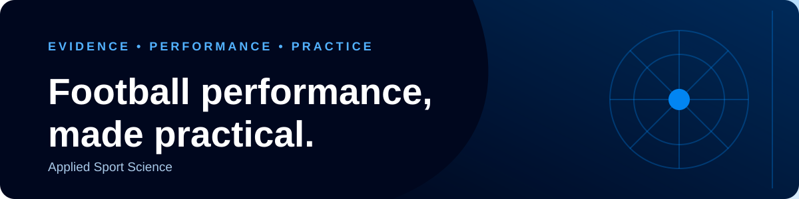

  

  

<h1 align="center">John Chisholm, MSc, ASCC, CSCS</h1>

<strong>Applied Sport Scientist · Strength & Conditioning Coach · Sports Technology</strong>

  <a href="https://appliedsportscience.co.uk">Website</a>
  &nbsp;·&nbsp;
  <a href="https://lab.appliedsportscience.co.uk">GPS &amp; Power BI Practice Lab</a>

I’m an applied sport scientist and accredited strength and conditioning coach with experience across professional football, youth academy development and education. Through **Applied Sport Science**, I connect evidence, coaching practice and technology to make performance information useful in the real world.

## Projects

| Project | Overview |
| --- | --- |
| **AS Performance** · *In development* | A player-focused strength & conditioning app in development. |
| **[GPS & Power BI Practice Lab](https://lab.appliedsportscience.co.uk)** | Six guided exercises using football GPS data, from building a report to interpreting what it shows. |
| **[Applied Sport Science](https://appliedsportscience.co.uk)** | Practical football performance support, applied work, insights and resources for coaches and practitioners. |

## Areas of focus

- Strength & conditioning and football performance
- Youth athlete development
- Speed, power and neuromuscular performance
- GPS monitoring and training load
- Performance analytics and data visualisation
- Applied research and evidence-informed practice

<strong>Evidence · Performance · Practice</strong>

